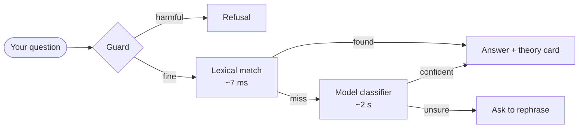

<div align="center">



# Σuler.SC

**A symbolic calculator with a local AI tutor. No account, no cloud, no telemetry.**

[](CHANGELOG.md)
[](#installation)
[](https://www.python.org)
[](LICENSE.txt)
[](#interface-languages)
[](#privacy)

[Features](#features) · [Installation](#installation) · [AI assistant](#the-ai-assistant) ·
[Building](#building-from-source) · [Changelog](CHANGELOG.md) · [Architecture](ARCHITECTURE.md)

</div>

---

## Why this exists

> **History.** This is the continuation of
> [SmartCalculator](https://github.com/M1kLuXamAkLay/SmartCalculator), which
> went from 1.0.0 to 1.3.0 before the rewrite. Every version since, and why each
> one exists, is in [CHANGELOG.md](CHANGELOG.md).

Most math apps either solve everything for you or nothing at all. This one is
built for the middle of a homework session: type an expression, get an exact
answer in the form a teacher expects, and when a theorem is the actual question
the assistant explains it instead of inventing numbers.

It runs entirely on your machine. The only network call is to a language model
running locally on `127.0.0.1`.

## Features

<table>
<tr>
<td width="50%" valign="top">

### 🧮 Calculator

- Exact arithmetic through SymPy — no floating-point drift
- Results pick the readable form automatically: `11/2` shows as `5½`,
  `sqrt(125)` as `5√5`, `0.000012345` as `1.2345×10⁻⁵`
- **ALT** cycles representations: exact, decimal, scientific, mixed, radical
- Named matrices `A`–`H` persist between sessions
- Three keyboard layouts (functions, analysis, equations)

</td>
<td width="50%" valign="top">

### 📈 Analysis

- Limits — two-sided and one-sided, with the working shown
- Derivatives up to order 10
- Indefinite and definite integrals
- Domain, range, asymptotes, extrema, monotonicity, inflection
- Live graph with pan and zoom, plus a fullscreen view
- Grid steps follow a 1/2/5 sequence at any zoom level

</td>
</tr>
<tr>
<td width="50%" valign="top">

### 🤖 AI assistant

- Runs on [Ollama](https://ollama.com) — local, offline, no API key
- **145 theorems and formulas** as grounding, so formulas are quoted, not recalled
- Describes a theorem in your own words — even with typos — and it finds it
- Conversation tabs with independent histories
- Streaming answers, `Enter` to send

</td>
<td width="50%" valign="top">

### 🛡️ Safety and privacy

- Refuses requests for weapons, drugs, malware, violence, and child sexual content
- Self-harm gets a helpline message, not a lecture
- Masked profanity rather than refusals — you came here for mathematics
- Nothing leaves the machine: no accounts, no analytics, no remote calls

</td>
</tr>
</table>

## Installation

### Windows — installer

Download `EulerSC-Setup.exe` from [Releases](../../releases) and run it.

- Installs per-user into `%LOCALAPPDATA%\Programs\EulerSC`
- **No administrator rights**, no UAC prompt
- Creates Desktop and Start Menu shortcuts
- Registers in *Apps & features* with a working uninstaller
- Uninstalling removes app data; Ollama and its models are offered separately,
  because re-downloading several gigabytes is a bad surprise

### From source — any platform

```bash
git clone https://github.com/euler-project/euler.git
cd euler
python -m venv .venv

# Windows
.venv\Scripts\activate
# macOS / Linux
source .venv/bin/activate

pip install -r requirements.txt
python run.py
```

Requirements: **Python 3.10+**. On Windows the interface uses WebView2, which
ships with Windows 11 and current Windows 10; the installer offers a download
link if it is missing.

## The AI assistant

Optional. The calculator works fully without it.



Three layers, cheapest first. The model is slow on small hardware, so it only
sees what keyword matching could not resolve.

**Grounding.** Before answering, the question is matched against 145 theorems.
The best entries go into the system prompt as authoritative text, and are
rendered as cards under the answer. A 0.5B model quotes a supplied formula
correctly and invents one badly — that is the whole reason for the reference.

**Models.** The assistant picks a model that fits your hardware on first launch.

| Model | Size | RAM needed | Notes |
|---|---:|:---:|---|
| `qwen2.5:0.5b` | 400 MB | 2 GB | Fastest, weakest reasoning |
| `qwen2.5:3b` | 2 GB | 6 GB | Good balance for a laptop |
| `qwen2.5:7b` | 4.7 GB | 12 GB | Best answers, needs a GPU or 16 GB |
| `llava:7b` | 4.7 GB | 12 GB | Photographs of tasks (vision) |

Models are downloaded from Ollama, not from this project. Settings has a
**Delete model** button, because otherwise reclaiming the disk space needs a
terminal.

## Building from source

<table>
<tr><th align="left">Command</th><th align="left">Produces</th><th align="left">Requires</th></tr>
<tr>
<td><code>build.bat</code></td>
<td>Installer, ~120 MB</td>
<td>Python 3.10+ on the target machine</td>
</tr>
<tr>
<td><code>build.bat bundled</code></td>
<td>Installer, ~160 MB</td>
<td>Nothing — ships a private Python runtime</td>
</tr>
<tr>
<td><code>./build/build.sh</code></td>
<td>Frozen directory</td>
<td>macOS / Linux; skips the Windows installer</td>
</tr>
</table>

Build machine needs Python 3.10+, `pip`, and [NSIS 3.x](https://nsis.sourceforge.io)
for the installer step. The script installs PyInstaller itself.

```bash
build.bat bundled          # Windows, self-contained installer
./build/build.sh           # macOS / Linux
```

## Tech stack

<div align="center">


</div>

| Layer | Choice | Why |
|---|---|---|
| Algebra | [SymPy](https://www.sympy.org) | Exact results; no numeric drift in `11/2` |
| Numerics | [NumPy](https://numpy.org) | Plot sampling only |
| Window | [pywebview](https://pywebview.flowrl.com) | Native shell around the system WebView; no Electron |
| Formulas | [MathLive](https://mathlive.io) | Editable LaTeX in and out |
| Markdown | [marked](https://marked.js.org) | Small, fast, no framework |
| AI | [Ollama](https://ollama.com) | Local inference, one HTTP port, no keys |
| Fonts | DejaVu Sans | Cyrillic, Greek and CJK in exported PDFs |

No frontend framework. The interface is vanilla JavaScript over a loopback HTTP
server with a per-launch token — which also makes every screen testable in a
plain browser (see `HOW_TO_RUN.md`).

## Interface languages

English · Русский · 中文 · Español · Français · বাংলা · Português

The language chosen in the installer seeds the interface on first launch.
Theorem titles, error messages and the assistant's answers all follow it.

## Data and privacy

| Platform | Settings, logs, exports |
|---|---|
| Windows | `%APPDATA%\EulerSC\` |
| Linux | `~/.local/share/EulerSC/` |
| macOS | `~/Library/Application Support/EulerSC/` |

Contains `settings.json`, `logs/app.log` (rotating, 3 × 1 MB) and `exports/`.

**What leaves your machine:** nothing. The interface is served on `127.0.0.1`
with a token generated per launch. The assistant talks to a model on the same
loopback address. There is no analytics, no crash reporting, and no update
check.

## Testing

```bash
pytest tests/ -q            # 40 unit tests
python tests/sweep_full.py  # 199 end-to-end checks
```

The sweep covers parsing, solving, calculus, matrices, formatting, the theorem
reference, ranking quality, the request guard and intent classification. It
prints a single `199/199 passed` line, and is run before every release.

## Project layout

```
euler/
  core/          mathematics, no UI and no network
    parser       safe expression parsing, allow-list of names
    solver       arithmetic, equations, systems
    analysis     domain, range, asymptotes, extrema
    calculus     limits, derivatives, integrals
    matrix       named registry A–H
    grapher      sampling with discontinuity splits
    reference    145 theorems, ranking, prompt grounding
    intent       lexical → model classifier → ask back
    guard        declines harmful requests, masks profanity
    llm          Ollama client: streaming, JSON mode, lifecycle
  bridge/api     the only callable surface, allow-listed
  transport      loopback HTTP with a per-launch token
app/web/         index.html, app.js, i18n.js, theme.css
build/           PyInstaller spec, NSIS installer, build scripts
tests/           unit tests and the release sweep
```

## Contributing

Issues and pull requests are welcome. Before opening a PR:

1. `pytest tests/ -q` and `python tests/sweep_full.py` must pass.
2. A behaviour change needs a test in `tests/sweep_full.py`.
3. `CHANGELOG.md` gets an entry under `[Unreleased]`.

## License

MIT — see [LICENSE](LICENSE.txt). Bundled third-party components and their
licences are listed at the end of that file.

<div align="center">
<sub>Built for students who need to see the working, not just the answer.</sub>
</div>
